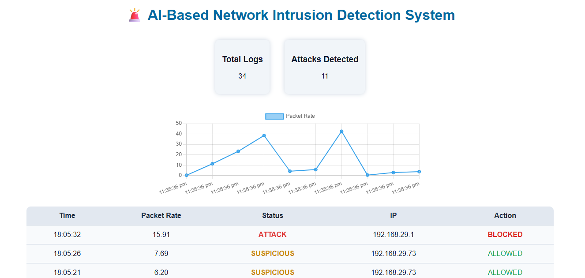
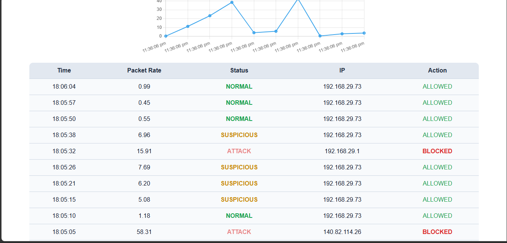
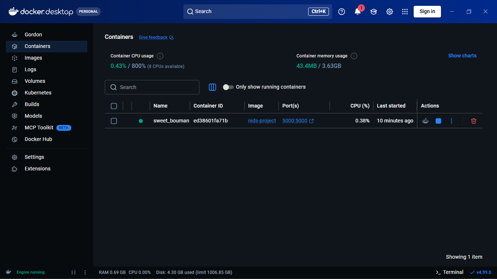
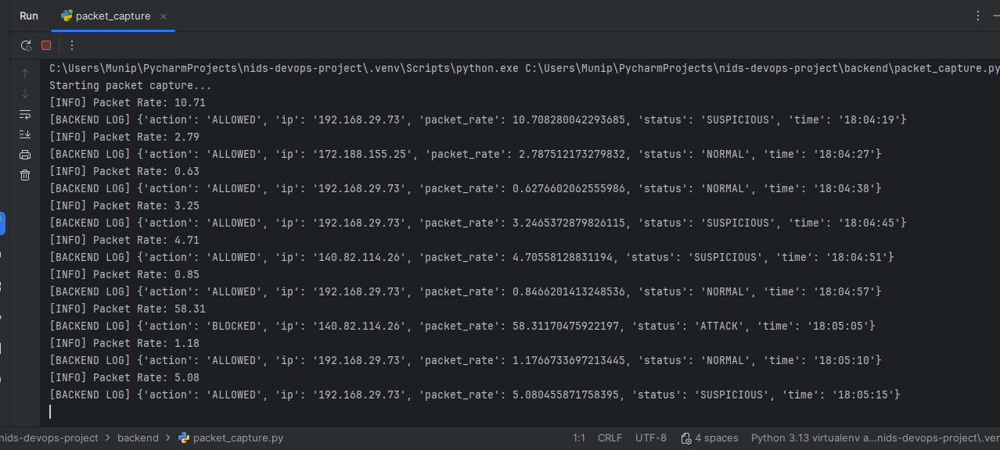

# 🛡️ AI-Based Network Intrusion Detection System (NIDS) with DevOps

A real-time Network Intrusion Detection System built with Python, Scapy, and a Dockerized backend API, paired with a live web monitoring dashboard and CI/CD automation.

---

## 🚀 Key Features
* **Live Packet Sniffing:** Captures real-time network packets using Scapy (`packet_capture.py`) and computes live packet rates per IP address.
* **Threat Classification & Automated Blocking:** Evaluates traffic against dynamic thresholds (`detection.py`, `firewall.py`) to classify flows as `NORMAL`, `SUSPICIOUS`, or `ATTACK`, automatically marking malicious spikes as `BLOCKED`.
* **Real-Time Web Dashboard:** Interactive UI (`index.html`, `dashboard.js`, `styles.css`) displaying total logs, detected attacks, live packet rate charts, and IP action logs.
* **Containerized DevOps Architecture:** Packaged with Docker (`devops/Dockerfile`) and configured for automated CI/CD workflows (`devops/github-actions.yaml`).

---

## 📊 System Screenshots

### 1. Real-Time Monitoring Dashboard
Displays live packet rate trends, total processed logs, and detected attack counts.


### 2. Live Traffic & Intrusion Logs
Tracks timestamps, packet rates, threat statuses (`NORMAL`, `SUSPICIOUS`, `ATTACK`), source IPs, and automated firewall actions (`ALLOWED` / `BLOCKED`).


### 3. Docker Container Deployment
Backend service containerized and running on port `5000` via Docker Desktop.


### 4. Live Packet Capture Console
Real-time Scapy packet sniffer streaming telemetry to the backend `/analyze` endpoint.


---

## 🛠️ Project Structure
```text
nids-devops-project/
├── assets/                 # Dashboard, Docker, and terminal screenshots
├── backend/
│   ├── app.py              # Main backend API server
│   ├── detection.py        # Anomaly threshold and escalation logic
│   ├── firewall.py         # Automated IP blocking rules
│   ├── model.py            # Detection model logic
│   ├── packet_capture.py   # Live Scapy packet sniffer
│   └── utils.py            # Helper functions
├── devops/
│   ├── Dockerfile          # Docker image build instructions
│   └── github-actions.yaml # CI/CD pipeline configuration
├── frontend/
│   ├── index.html          # Monitoring dashboard interface
│   ├── dashboard.js        # Chart.js & live log polling logic
│   └── styles.css          # Dashboard styling
├── data/                   # Traffic datasets and logs
└── requirements.txt        # Python dependencies